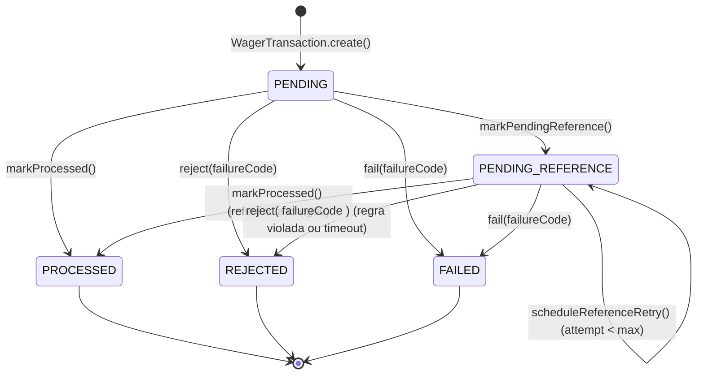

# Architecture & Design Decisions — Distributed Wagering Processor

Este documento detalha as decisões arquiteturais, garantias de invariantes financeiras, controle de concorrência entre múltiplas instâncias, idempotência persistente, mensageria atômica (Transactional Inbox/Outbox) e resultados experimentais de carga.

---

## 1. Visão Geral da Arquitetura (DDD & Clean/Hexagonal Boundaries)

O projeto é estruturado em quatro camadas estritamente isoladas:

```
src/
├── domain/                     # Puro TypeScript + Decimal.js (zero dependências de NestJS ou MikroORM)
│   ├── value-objects/          # Money (imutável, escala fixa 2 casas decimais)
│   ├── entities/               # Wallet (Aggregate Root), WagerTransaction, WalletLedgerEntry, InboxMessage, OutboxMessage
│   ├── events/                 # IntegrationEvent<T> (abstrata) + subclasses concretas tipadas
│   ├── services/               # WageringDomainService (regras puras de BET, WIN, LOSS, REFUND, ROLLBACK)
│   ├── errors/                 # Hierarquia DomainError + taxonomia estável de FailureCode
│   └── utils/                  # Canonical JSON (RFC 8785 style) + SHA-256 payloadHash
├── application/                # Orquestração transacional e casos de uso
│   ├── use-cases/              # CreateWallet, ProcessWagerTransaction (compartilhado HTTP/SQS), ReconcileWallet, QueryWagering
│   └── workers/                # SqsWagerConsumer, OutboxPublisherWorker, PendingReferenceRetryWorker
├── infrastructure/             # Adaptadores externos (PostgreSQL, MikroORM, SQS, Logs, Métricas)
│   ├── database/               # EntitySchemas, Mappers (rehydrate), Migration reversível com Triggers e Constraints
│   ├── messaging/              # SqsClientService (@aws-sdk/client-sqs)
│   └── observability/          # StructuredLogger (JSON) e MetricsService (Prometheus + JSON)
└── presentation/               # Entrada HTTP, Auth Port/Guard, Exception Filter
    ├── auth/                   # ProviderIdentityPort, ProviderAuthGuard, @Public()
    ├── controllers/            # WalletsController, WageringController, HealthAndMetricsController
    └── filters/                # GlobalDomainExceptionFilter
```

### Encapsulamento do Domínio e Reidratação (`rehydrate`)
* Todas as classes de domínio ([`Money`](./src/domain/value-objects/money.ts), [`Wallet`](./src/domain/entities/wallet.ts), [`WagerTransaction`](./src/domain/entities/wager-transaction.ts), [`WalletLedgerEntry`](./src/domain/entities/wallet-ledger-entry.ts), [`InboxMessage`](./src/domain/entities/inbox-message.ts), [`OutboxMessage`](./src/domain/entities/outbox-message.ts)) possuem **construtores `private`** e expõem apenas factories estáticas:
  * `create` / `open` / `from` / `receive` / `enqueue`: validam todas as pré-condições e regras de transição de negócio.
  * `rehydrate`: reconstrói o estado persistido no banco de dados sem reexecutar regras de transição de entrada.
* O domínio **não importa** decorators do NestJS nem tipos do MikroORM. O mapeamento ORM é definido externamente via `EntitySchema` em [`persistence-entities.ts`](./src/infrastructure/database/entities/persistence-entities.ts).

---

## 2. Escolha do ORM, Mapeamento de `Money` e Estratégia Transacional

### Por que MikroORM?
Escolhemos o **MikroORM (`@mikro-orm/postgresql`)** por oferecer:
1. **Controle explícito de Unit of Work e Transações**: `em.transactional(async (txEm) => { ... })` garante que todas as operações de leitura, lock pessimista e escrita ocorram dentro de um único bloco `BEGIN ... COMMIT` no PostgreSQL.
2. **Suporte nativo a Pessimistic Locking**: `LockMode.PESSIMISTIC_WRITE` emite `SELECT ... FOR UPDATE` diretamente na linha da carteira.
3. **`EntitySchema` desacoplado**: permite mapear tabelas relacionais sem acoplar decorators de persistência às entidades de domínio.

### Mapeamento Exato de `Money`
* **Em memória (Domínio)**: [`Money`](./src/domain/value-objects/money.ts) encapsula uma instância imutável de `Decimal` (`decimal.js`) e o código ISO-4217 (`currency`), congelada com `Object.freeze(this)`. Rejeita `number`, `NaN`, `Infinity`, notação científica (`1e5`), strings vazias, valores negativos em contratos de entrada e valores com mais de 2 casas decimais.
* **No PostgreSQL**:
  * Valor e moeda ocupam colunas separadas: `NUMERIC(20, 2)` (ex.: `balance_amount`, `money_amount`, `balance_before_amount`, `balance_after_amount`) e `CHAR(3)` (`currency` / `money_currency`).
  * O driver PostgreSQL retorna `NUMERIC(20, 2)` como `string` exata, evitando qualquer conversão intermediária por IEEE-754 `float`/`number`. Na leitura, `Money.rehydrate({ amount, currency })` reconstrói o Value Object com precisão exata.

---

## 3. Garantias no Schema do Banco de Dados (Defesa em Profundidade)

As invariantes financeiras e de idempotência não dependem apenas da camada de aplicação em TypeScript — elas são impostas diretamente pelo PostgreSQL na migration reversível [`Migration20261015200843_InitialSchema.ts`](./src/infrastructure/database/migrations/Migration20261015200843_InitialSchema.ts):

| Tabela | Invariante | Mecanismo no PostgreSQL |
|---|---|---|
| `wallets` | Máximo 1 wallet por `playerId + currency` | `CONSTRAINT uq_wallets_player_currency UNIQUE (player_id, currency)` |
| `wallets` | Saldo nunca negativo | `CONSTRAINT chk_wallets_balance_non_negative CHECK (balance_amount >= 0)` |
| `wallets` | Versão sempre $\ge 1$ | `CONSTRAINT chk_wallets_version_positive CHECK (version >= 1)` |
| `wager_transactions` | Unicidade da chave de idempotência | `CONSTRAINT uq_wager_tx_idempotency_key UNIQUE (idempotency_key)` |
| `wager_transactions` | Unicidade por provedor + ID externo | `CONSTRAINT uq_wager_tx_provider_external UNIQUE (provider_id, external_transaction_id)` |
| `wager_transactions` | Proibição de dupla reversão (`REFUND`/`ROLLBACK`) | Índice parcial único: `CREATE UNIQUE INDEX uq_wager_tx_single_processed_reversal ON wager_transactions (reference_transaction_id) WHERE status = 'PROCESSED' AND kind IN ('REFUND', 'ROLLBACK') AND reference_transaction_id IS NOT NULL` |
| `wager_transactions` | Estados terminais (`PROCESSED`, `REJECTED`, `FAILED`) imutáveis e não-excluíveis | Trigger `BEFORE UPDATE OR DELETE`: `trg_guard_wager_transaction_terminal` |
| `wallet_ledger_entries` | No máximo 1 lançamento por transação e carteira | `CONSTRAINT uq_ledger_wallet_tx UNIQUE (wallet_id, transaction_id)` |
| `wallet_ledger_entries` | Equilíbrio aritmético (`balance_before ± money = balance_after`) | `CONSTRAINT chk_ledger_arithmetic_balanced CHECK (...)` |
| `wallet_ledger_entries` | Imutabilidade estrutural (append-only) | Trigger `BEFORE UPDATE OR DELETE`: `trg_wallet_ledger_immutable` (bloqueia qualquer `UPDATE` ou `DELETE`) |
| `inbox_messages` | Deduplicação persistente por consumidor e mensagem | `PRIMARY KEY (consumer_name, message_id)` |

---

## 4. Estratégia de Concorrência e Ordenação

A **unidade de concorrência é a `walletId`**.

### Pessimistic Write Locking (`SELECT ... FOR UPDATE`) por `walletId` + Versionamento
Optamos por **Pessimistic Write Locking no nível da linha da `Wallet`** (`LockMode.PESSIMISTIC_WRITE`) combinado com incremento explícito de `version` e constraints de banco:

1. **Isolamento entre carteiras distintas**: Transações em carteiras diferentes bloqueiam linhas distintas em `wallets`, executando 100% em paralelo sem contenção global.
2. **Comportamento sob alta contenção ("Hot Wallet")**: Quando múltiplas instâncias processam operações simultâneas para a mesma `walletId` (por exemplo, duas apostas de `80.00 BRL` disputando um saldo de `100.00 BRL`, ou 50 replays paralelos da mesma aposta):
   * Com Optimistic Locking puro, $N-1$ transações concorrentes falham com `OptimisticLockError` e precisam reexecutar ou ser rejeitadas com erro transitório.
   * Com `SELECT ... FOR UPDATE` na linha da `Wallet`, o PostgreSQL enfileira as transações concorrentes daquela mesma carteira na ordem de chegada do lock:
     * A 1ª aposta de `80.00 BRL` lê `100.00 BRL`, debita para `20.00 BRL` (`version = 2`), grava o ledger e confirma (`PROCESSED`).
     * A 2ª aposta de `80.00 BRL` adquire o lock logo após o commit da 1ª, enxerga o saldo atualizado de `20.00 BRL` e é deterministicamente marcada como `REJECTED` (`INSUFFICIENT_FUNDS`), sem gerar retry desnecessário.
     * Nos 50 envios paralelos da **mesma** aposta, a 1ª requisição adquire o lock da carteira e grava a transação; as 49 seguintes, ao adquirirem o lock da carteira e re-verificarem a tabela `wager_transactions`, encontram a transação já persistida e retornam imediatamente o replay idempotente (`idempotentReplay: true`).
3. **Fallback para Race de `UNIQUE` Constraint**: Caso duas requisições com a mesma `Idempotency-Key` mas apontando para `walletId`s distintos cheguem simultaneamente e colidam na constraint `uq_wager_tx_idempotency_key` (`SQLSTATE 23505`), o caso de uso captura a violação, incrementa a métrica `wagering_lock_conflicts_total` e consulta o registro vencedor para retornar o replay idempotente ou lançar `IdempotencyConflictError` (`409 Conflict`) se o hash do payload divergir.

---

## 5. Idempotência e Hash Canônico (`payloadHash`)

* **Fonte da verdade**: Header `Idempotency-Key` (na API HTTP) ou campo `idempotencyKey` / `"{providerId}:{externalTransactionId}"` (no SQS).
* **Algoritmo de `payloadHash`** ([`canonical-json.ts`](./src/domain/utils/canonical-json.ts)):
  1. Seleciona exclusivamente o subconjunto de campos de negócio: `providerId`, `externalTransactionId`, `playerId`, `walletId`, `roundId`, `gameId`, `kind`, `money: { amount, currency }` e `referenceExternalTransactionId` (quando presente). Metadados de transporte (headers HTTP, `messageId`, `occurredAt`) são excluídos.
  2. Serializa o objeto recursivamente com **chaves ordenadas lexicograficamente** (estilo RFC 8785), sem espaços em branco.
  3. Calcula o digest **SHA-256** hexadecimal (64 caracteres).
* **Saldo Observado (`observedBalance`)**:
  * Toda transação terminal armazena em `wager_transactions` o saldo exato da carteira no instante em que foi processada (`observed_balance_amount`).
  * Assim, mesmo que apostas posteriores alterem o saldo da carteira, repetir uma operação antiga retorna **exatamente o resultado e o saldo observados naquele momento** (`idempotentReplay: true`).

---

## 6. Taxonomia de `FailureCode` e Mapeamento de Status HTTP

Toda rejeição ou erro retorna um `failureCode` estável e legível por máquina ([`domain-errors.ts`](./src/domain/errors/domain-errors.ts)), permitindo que o provedor decida deterministicamente sua ação:

| Categoria | `FailureCode` | Status HTTP | Ação Recomendada ao Provedor |
|---|---|---|---|
| **Sucesso / Replay** | — (`status: "PROCESSED"`) | `200 OK` | Confirmado; não reenviar. |
| **Aceite Assíncrono (Fora de Ordem)** | — (`status: "PENDING_REFERENCE"`) | `202 Accepted` | Aceito; aguardando chegada da transação referenciada. |
| **Rejeição de Regra de Negócio** (Persistida como `REJECTED`) | `INSUFFICIENT_FUNDS`<br>`NEGATIVE_BALANCE_ON_REVERSAL`<br>`CURRENCY_MISMATCH`<br>`INVALID_REFERENCE_KIND`<br>`REFERENCE_CONTEXT_MISMATCH`<br>`REFERENCE_AMOUNT_MISMATCH`<br>`REFERENCE_NOT_PROCESSED`<br>`DUPLICATE_REVERSAL`<br>`REFERENCE_NOT_FOUND_TIMEOUT` | `422 Unprocessable Entity` | Terminal; **não reenviar** (regra de negócio violada; carteira intacta). Note a distinção operacional entre `INSUFFICIENT_FUNDS` (aposta sem saldo) e `NEGATIVE_BALANCE_ON_REVERSAL` (estorno de crédito cujo saldo já foi consumido). |
| **Conflito de Idempotência / Duplicidade** | `IDEMPOTENCY_PAYLOAD_CONFLICT`<br>`EXTERNAL_TX_CONFLICT`<br>`WALLET_ALREADY_EXISTS` | `409 Conflict` | Erro de integração do provedor (reuso de chave com payload divergente ou carteira já existente); **não reenviar sem corrigir**. |
| **Payload / Contrato Inválido** | `INVALID_MONEY`<br>`INVALID_PAYLOAD`<br>`MISSING_REFERENCE_ID`<br>`FORBIDDEN_OPENING_KIND`<br>`IDEMPOTENCY_KEY_REQUIRED` | `400 Bad Request` | Payload malformado; corrigir contrato antes de enviar nova transação. |
| **Recurso Não Encontrado** | `WALLET_NOT_FOUND`<br>`TRANSACTION_NOT_FOUND` | `404 Not Found` | Verificar existência do `walletId` / `transactionId`. |
| **Falha Transitória de Infraestrutura** | `INFRASTRUCTURE_FAILURE`<br>`CONCURRENCY_CONFLICT` | `503 Service Unavailable` | **Seguro reenviar** com a mesma `Idempotency-Key` e backoff exponencial. |

---

## 7. Referências Fora de Ordem (`PENDING_REFERENCE`)

Quando um `REFUND` ou `ROLLBACK` (ou `WIN` referenciando uma `BET`) chega antes da transação referenciada:
1. A transação é persistida com status `PENDING_REFERENCE`, `retry_attempts = 0` e `next_retry_at = NOW() + 100ms`, emitindo o evento `WagerTransactionPendingReference` na Outbox.
2. O worker agendado [`PendingReferenceRetryWorker`](./src/application/workers/pending-reference-retry.worker.ts) busca registros vencidos usando `FOR UPDATE SKIP LOCKED`.
3. Se a transação referenciada já chegou e está `PROCESSED`, aplica a movimentação financeira na carteira, gera o lançamento no ledger e publica `WalletBalanceChanged` + `WagerTransactionProcessed` na mesma transação SQL.
4. Se a referência continuar ausente, aplica **backoff exponencial**: $\text{delay} = 100\text{ms} \times 2^{\text{attempt}-1}$.
5. Ao atingir o limite configurável de tentativas (`PENDING_REF_MAX_ATTEMPTS`, padrão `8`), a transação transiciona para o estado terminal `REJECTED` com `failureCode = REFERENCE_NOT_FOUND_TIMEOUT` e publica `WagerTransactionRejected` na Outbox.

---

## 8. Mensageria SQS, Transactional Inbox & Outbox

### Consumidor SQS ([`SqsWagerConsumer`](./src/application/workers/sqs-wager.consumer.ts))
* Reutiliza o mesmo [`ProcessWagerTransactionUseCase`](./src/application/use-cases/process-wager-transaction.use-case.ts) da camada HTTP.
* Grava `InboxMessage` (`(consumer_name, message_id)`) **na mesma transação SQL** da alteração de saldo, ledger e outbox.
* Executa `DeleteMessage` (`ack`) no SQS **exclusivamente após o commit SQL**. Se o worker morrer após o commit e antes do `ack`, a reentrega encontra a `InboxMessage` / `idempotencyKey` já processada e confirma a mensagem sem duplicar efeitos.
* Em `SIGTERM`, interrompe o polling, aguarda a conclusão das mensagens em voo e devolve imediatamente a visibilidade (`ChangeMessageVisibility(0)`) de qualquer mensagem pendente.

### Transactional Outbox ([`OutboxPublisherWorker`](./src/application/workers/outbox-publisher.worker.ts))
* Nenhum evento é publicado no broker antes do commit da transação financeira.
* Múltiplos publishers concorrentes selecionam lotes disjuntos com:
  ```sql
  SELECT ... FROM outbox_messages
  WHERE published_at IS NULL AND (next_attempt_at IS NULL OR next_attempt_at <= NOW())
  ORDER BY occurred_at ASC LIMIT 50
  FOR UPDATE SKIP LOCKED
  ```
* Publica na fila FIFO `wager-integration-events.fifo` usando `MessageGroupId = aggregateId` (`walletId`) e `MessageDeduplicationId = outbox.id` (`eventId`), garantindo ordenação por carteira e deduplicação no broker.

---

## 9. Autenticação — Ponto de Extensão e Desenho OIDC

### Ponto de Extensão no Código
* Definimos a porta abstrata [`ProviderIdentityPort`](./src/presentation/auth/provider-identity.port.ts#L19-L23) e o guard global [`ProviderAuthGuard`](./src/presentation/auth/provider-identity.port.ts#L45-L70) registrado via `APP_GUARD` no [`AppModule`](./src/app.module.ts).
* Os endpoints `/health/live`, `/health/ready` e `/metrics` são marcados com o decorator `@Public()`, ficando abertos sem autenticação.
* As mensagens consumidas via fila SQS entram pelo canal interno confiável (`SqsWagerConsumer`), mantendo todas as validações de domínio sobre `providerId`, `playerId` e `walletId`.

### Desenho de Produção com Keycloak / Zitadel (OAuth 2.0 Client Credentials + OIDC)
Em ambiente produtivo multi-provedor:
1. **Identity Provider**: Cada provedor de jogos (`provider-a`, `provider-b`) recebe um *Confidential Client* no **Keycloak** (ou *Machine-to-Machine Service User* no **Zitadel**) com fluxo `client_credentials` (ou `private_key_jwt` mTLS/JWT).
2. **Token JWT Assinado (RS256/ES256)**: O IdP emite um Access Token de curta duração (ex.: 5 min) contendo as claims:
3. **Claims Esperadas**:
   * `iss`: URL do realm no Keycloak/Zitadel
   * `aud`: `"wagering-processor-api"`
   * `sub`: client ID do provedor
   * `provider_id`: identificador canônico do provedor (ex.: `"provider-a"`)
   * `scope`: `"wagering:write wagering:read"`
4. **Validação Stateless no `OidcJwksProviderIdentityAdapter`**:
   * Implementa `ProviderIdentityPort` validando a assinatura do Bearer Token contra o endpoint JWKS (`/.well-known/jwks.json`) do Keycloak/Zitadel com cache local de chaves públicas e rotação automática por `kid`.
   * Verifica `exp`, `nbf`, `iss`, `aud` e garante que `principal.providerId === body.providerId`, impedindo que um provedor autenticado submeta transações em nome de outro `providerId`.

---

## 10. Experimento de Teste de Carga (`bun run test:load`)

Executamos o benchmark automatizado ([`scripts/load-test.ts`](./scripts/load-test.ts)) com **3 instâncias simultâneas** da aplicação NestJS compartilhando o mesmo banco PostgreSQL 16 e fila SQS:

### Metodologia (3 Fases)
* **Fase 1 — Paralelismo Multi-Wallet**: 200 transações (`BET` e `WIN`) distribuídas entre 20 carteiras independentes (concorrência = 20) balanceadas em round-robin entre as 3 instâncias.
* **Fase 2 — Contenção Extrema em "Hot Wallet"**: 80 apostas concorrentes de `10.00 BRL` (concorrência = 25) disputando simultaneamente uma única carteira com saldo inicial de `500.00 BRL` (esperado: exatamente 50 `PROCESSED`, 30 `REJECTED` com `INSUFFICIENT_FUNDS`, saldo final `0.00 BRL`).
* **Fase 3 — Tempestade de Replays Idempotentes**: 100 requisições simultâneas (concorrência = 25) enviando a mesma aposta com a mesma `Idempotency-Key` nas 3 instâncias (esperado: 1 débito real + 99 replays idempotentes).
* **Verificação Final**: Drenagem completa da Outbox e execução do endpoint `POST /wallets/:walletId/reconciliation` nas 21 carteiras.

### Resultados Medidos (`bun run test:load`)

| Fase | Requisições | Concorrência | Duração (ms) | Throughput (RPS) | `200 OK` | `422 Rejected` | Erros `5xx` | `p50` (ms) | `p95` (ms) | `p99` (ms) |
|---|---:|---:|---:|---:|---:|---:|---:|---:|---:|---:|
| **Phase 1 — Multi-Wallet Parallel (20 Wallets, 3 Nodes)** | 200 | 20 | 3641.23 | 54.93 | 200 | 0 | 0 | 367.02 | 464.79 | 491.37 |
| **Phase 2 — Hot-Wallet Contention (1 Wallet, 80 Bets vs 500 BRL)** | 80 | 25 | 1067.85 | 74.92 | 50 | 30 | 0 | 314.75 | 401.16 | 411.03 |
| **Phase 3 — Idempotent Replay Storm (100 Parallel Replays)** | 100 | 25 | 413.54 | 241.81 | 100 | 0 | 0 | 89.77 | 145.94 | 159.07 |

* **Consistência Financeira Final**: `21/21` carteiras reconciliadas com `consistent: true` e `difference: "0.00 BRL"` (`272` lançamentos de ledger verificados).
* **Hot Wallet**: Saldo final cravado em `0.00 BRL` (50 apostas processadas, 30 rejeitadas por `INSUFFICIENT_FUNDS`, zero saldo negativo, zero lost updates).
* **Tempestade de Duplicatas**: `99/100` detectadas como `idempotentReplay: true`, apenas `1` lançamento de débito no ledger.
* **Taxa de Erro 5xx**: `0%` (`0` erros em todas as fases).
* **Outbox Lag Final**: `574` eventos publicados, `0` mensagens pendentes (`0 ms` lag após drenagem dos workers concorrentes).

---

## 11. Máquina de Estados de `WagerTransaction`

Toda instância de [`WagerTransaction`](./src/domain/entities/wager-transaction.ts) nasce em `PENDING` via `WagerTransaction.create()` e segue transições explícitas e unidirecionais:



| Estado de Origem | Estado de Destino | Método de Domínio | Condição / Gatilho | Terminal? |
|---|---|---|---|---|
| `(novo)` | `PENDING` | `WagerTransaction.create()` | Validação contratual inicial ao instanciar a transação | Não |
| `PENDING` | `PROCESSED` | `markProcessed(refId, at, balance)` | Regras de negócio e saldo validados com sucesso | **Sim** |
| `PENDING` | `REJECTED` | `reject(code, at, balance)` | Violação de regra de negócio (ex.: `INSUFFICIENT_FUNDS`, `DUPLICATE_REVERSAL`) | **Sim** |
| `PENDING` | `FAILED` | `fail(code, at, balance)` | Falha permanente auditável | **Sim** |
| `PENDING` | `PENDING_REFERENCE` | `markPendingReference(nextRetryAt)` | `referenceExternalTransactionId` ainda não existe ou não está em estado terminal | Não |
| `PENDING_REFERENCE` | `PENDING_REFERENCE` | `scheduleReferenceRetry(now, baseDelayMs)` | Referência continua ausente e `retryAttempts + 1 < maxAttempts` | Não |
| `PENDING_REFERENCE` | `PROCESSED` | `markProcessed(refId, at, balance)` | Referência localizada pelo worker agendado e movimentação aplicada | **Sim** |
| `PENDING_REFERENCE` | `REJECTED` | `reject(code, at, balance)` | Referência localizada mas inválida, ou limite de tentativas esgotado (`REFERENCE_NOT_FOUND_TIMEOUT`) | **Sim** |

*Qualquer tentativa de invocar métodos de transição a partir de `PROCESSED`, `REJECTED` ou `FAILED` lança `InvalidTransactionStateError` no domínio e é bloqueada no banco pela trigger `trg_guard_wager_transaction_terminal`.*

---

## 12. Interpretações Adicionais de Negócio e Justificativa do TTL

1. **Bloqueio Cruzado entre `REFUND` e `ROLLBACK` sobre uma mesma `BET`**:
   * Além de impedir duas operações do mesmo tipo sobre a mesma referência, também impedimos que uma `BET` já estornada por `REFUND` sofra posteriormente um `ROLLBACK` (ou vice-versa). Ambas as operações creditariam o valor da aposta de volta ao jogador; portanto, permitir ambas violaria a invariante global contra duplicação de crédito. Isso é garantido tanto em [`WageringDomainService`](./src/domain/services/wagering-domain-service.ts) quanto no índice parcial único `uq_wager_tx_single_processed_reversal` no PostgreSQL.
2. **`WIN` com ou sem `referenceExternalTransactionId`**:
   * O campo `referenceExternalTransactionId` é opcional para `WIN`. Quando informado, o sistema valida que a transação referenciada existe (ou aguarda em `PENDING_REFERENCE` se ainda não chegou), pertence ao mesmo contexto (`providerId`, `playerId`, `walletId`, `roundId`, `currency`), é do tipo `BET` e está `PROCESSED`. Quando omitido (ex.: prêmio de bônus/free spin da rodada), o crédito é aplicado diretamente.
3. **`LOSS` com valor zero (`0.00 BRL`) ou positivo**:
   * Como `LOSS` apenas registra o resultado da rodada sem afetar o saldo nem gerar entrada no ledger, aceitamos tanto `0.00` quanto o valor nominal perdido na rodada, mantendo `wallet.balance` e `wallet.version` inalterados e emitindo apenas `WagerTransactionProcessed`.
4. **Justificativa do Limite de Tentativas e Backoff de `PENDING_REFERENCE`**:
   * Adotamos backoff exponencial $\text{delay}_n = \text{baseDelayMs} \times 2^{n-1}$ com `PENDING_REF_BASE_DELAY_MS = 100ms` e `PENDING_REF_MAX_ATTEMPTS = 8` (configuráveis via variáveis de ambiente).
   * **Por quê?** Na prática de provedores iGaming sob entrega *at-least-once* fora de ordem (por exemplo, redes entre provedor e agregador ou filas paralelas), a inversão de ordem entre `BET` e `ROLLBACK`/`REFUND` ocorre na janela de dezenas de milissegundos a poucos segundos. Os primeiros retries ($100\text{ms}, 200\text{ms}, 400\text{ms}, 800\text{ms}$) resolvem $>99\%$ das inversões quase em tempo real, enquanto os retries finais ($1.6\text{s}, 3.2\text{s}, 6.4\text{s}, 12.8\text{s}$, acumulando $\approx 25.5\text{s}$) absorvem atrasos maiores sem sobrecarregar o banco. Caso a `BET` jamais chegue (por exemplo, porque o próprio provedor abortou o envio antes de sair da origem), a transação é encerrada de forma determinística como `REJECTED` (`REFERENCE_NOT_FOUND_TIMEOUT`) e notificada via Outbox.

---

## 13. Trade-offs Arquiteturais e Limitações Conhecidas

### Comparativo de Estratégias de Concorrência na `Wallet`

| Critério | Pessimistic Locking (`SELECT ... FOR UPDATE`) *(Adotado)* | Optimistic Locking (`WHERE version = :v` + Retry) | Update Atômico Condicionado (`UPDATE wallets SET balance = balance - :amt WHERE balance >= :amt`) |
|---|---|---|---|
| **Prevenção de Lost Update / Saldo Negativo** | Forte (serializa por linha da `walletId`) | Forte, mas exige reexecução em caso de colisão | Forte para o saldo, mas exige leitura adicional para `balance_before`/`balance_after` do ledger |
| **Comportamento em "Hot Wallet" (alta contenção)** | Enfileira no lock de linha do Postgres; todas as transações válidas completam na 1ª tentativa sem abortar a transação SQL | Degradação sob contenção (efeito *thundering herd* de rollbacks e retries na aplicação) | Excelente throughput, porém dificulta validações complexas de domínio (como regras cruzadas de referência) antes do update |
| **Pureza do Modelo de Domínio (DDD)** | Preserva o Aggregate Root rico (`wallet.debit()` / `wallet.credit()`) | Preserva o Aggregate Root rico | Desloca lógica de domínio para dentro do SQL `UPDATE` |
| **Trade-off / Custo** | Mantém a conexão do pool ocupada durante o tempo da transação da carteira | Menor tempo de lock no banco quando não há colisão | Menor expressividade no modelo de domínio |

### Limitações Conhecidas e Evoluções para Produção
1. **Particionamento de Tabelas de Alto Crescimento (`wallet_ledger_entries`, `wager_transactions`, `outbox_messages`)**:
   * No escopo deste projeto, as tabelas são criadas como tabelas regulares. Em produção com dezenas de milhões de apostas/dia, `wallet_ledger_entries` e `outbox_messages` devem utilizar **particionamento declarativo do PostgreSQL (`PARTITION BY RANGE (created_at)`)** aliado a um job de retenção/arquivamento de mensagens já publicadas da Outbox (`published_at IS NOT NULL AND occurred_at < NOW() - INTERVAL '7 days'`).
2. **Pool de Conexões e `lock_timeout`**:
   * Como `SELECT ... FOR UPDATE` retém uma conexão durante a transação, em produção recomenda-se configurar `SET LOCAL lock_timeout = '3s'` e `statement_timeout = '5s'` por transação, além de posicionar **PgBouncer** em modo *transaction pooling* à frente do PostgreSQL.
3. **Notificação Push na Outbox (`LISTEN / NOTIFY` ou CDC)**:
   * O `OutboxPublisherWorker` utiliza polling curto (`200ms`) com `FOR UPDATE SKIP LOCKED`, que é extremamente simples, resiliente e seguro para múltiplos workers. Para reduzir o lag sub-10ms sem custo de polling ocioso, pode-se combinar o worker de polling (como fallback de segurança) com um gatilho `NOTIFY` ou *Change Data Capture* (Debezium).
